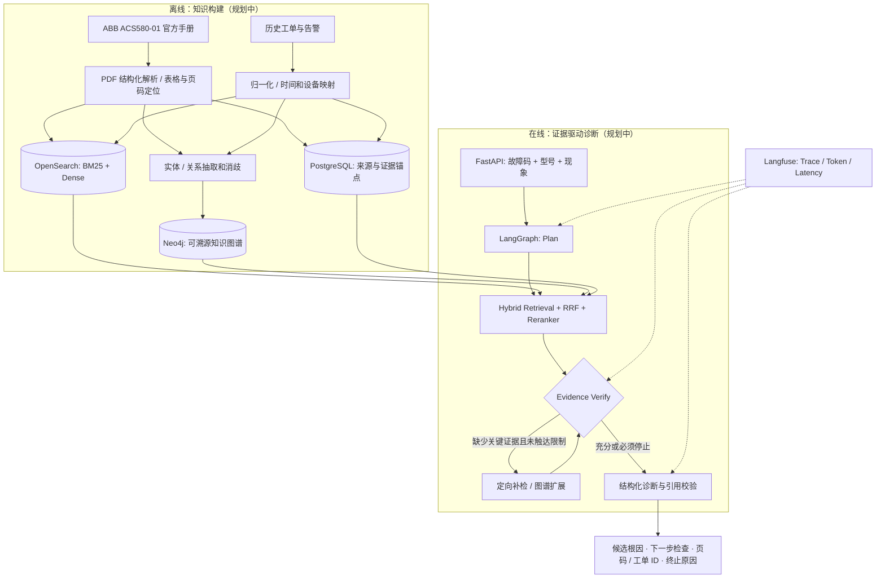

<div align="center">

# ⚙️ ForgeRCA

### Industrial Fault Diagnosis with Agentic GraphRAG

**让每一条故障推断都有证据，让每一步补检都有理由。**

*Evidence-grounded fault analysis for industrial equipment manuals, work orders and alarms.*

[](docs/demo-and-milestones.md)
[](#快速开始)
[](docs/project-scope.md)
[](TODO.md)
[](LICENSE)

[快速开始](#快速开始) · [系统架构](#系统架构) · [数据集](#公开数据与来源) · [开发路线](TODO.md) · [评测规范](docs/evaluation.md) · [参与贡献](CONTRIBUTING.md)

</div>

> [!IMPORTANT]
> **当前是数据与文档初始化阶段，而不是已上线的故障诊断产品。** 当前仓库已有设计文档、ABB 官方 PDF 来源清单、少量可追溯知识注释、**明确标识为合成**的工单及告警、开发/演示问题和离线校验脚本；尚未实现正式检索服务、Neo4j 入库、LangGraph Agent、诊断 API 或 Web 界面。下文描述的技术能力是**实现计划**，不是已运行功能。

## 🌟 为什么做 ForgeRCA？

工业故障调查通常面临四种信息断层：

| 常见困难 | 计划采用的解决方式 |
| --- | --- |
| 故障码被向量检索错过或误匹配 | **BM25 + Dense 双路召回**、故障码规范化与精确匹配 |
| 旧手册或异型号证据被错误引用 | **设备型号 / 文档修订 / 固件适用范围**联合过滤 |
| 故障现象、候选原因、检查步骤跨文件分散 | **Neo4j 证据约束知识图谱**与有界多跳检索 |
| 证据不足时回答编造，或 Agent 无意义循环 | **LangGraph 条件补检**、证据充分性判断、有限轮次与引用校验 |

目标不是代替维修工程师做决定，而是更快地获得**候选根因、必要检查项和可打开的原始来源**。

## 🧭 系统架构



### 核心技术方向

`Python` · `FastAPI` · `LangGraph` · `OpenSearch` · `Neo4j` · `PostgreSQL` · `BGE-M3` · `BGE-Reranker` · `Langfuse`

- **检索**：先复现 Dense-only 基线，再独立实现 BM25、RRF、BGE 重排及型号 / 版本过滤；用消融实验量化增益。
- **图谱**：以设备、部件、故障码、现象、候选原因、检查措施、来源证据为节点或实体；不允许无法追溯的关系直接变成确定结论。
- **Agent**：将补检作为有预算、有终止条件的条件分支；记录每次补检的证据缺口、策略、新证据与停止原因。
- **可信输出**：输出候选根因和待检查项，区分“手册可能原因”和“现场已经验证的根因”。

完整技术约束见 [架构设计](docs/architecture.md)、[项目范围](docs/project-scope.md) 和 [图谱设计](docs/knowledge-graph.md)。

## 🚀 快速开始

### 0. 前置条件

- Python **3.11+**；初始化脚本使用标准库，不需要模型 API Key、Docker 或数据库。开发工具（pytest / ruff / just）由 `uv` 管理，版本锁定在 `uv.lock`。
- 如果后续执行实际检索 / Agent 工作流，将按 [TODO](TODO.md) 引入数据库和模型依赖；**目前没有可运行的诊断 API**。

```bash
# 该公开仓库当前实际名称末尾含一个连字符
git clone https://github.com/abelferry-cloud/ForgeRCA-.git
cd ForgeRCA-

# 校验仓库已提供的种子工单、告警、证据映射和数据划分
python scripts/validate_data.py
python -m unittest discover -s tests -v

# 确认没有凭据、厂商原文或本地索引被纳入跟踪文件
python scripts/check_sensitive_files.py
```

开发时安装锁定工具，通过 `justfile` 的统一入口运行命令；Windows 使用系统 PowerShell，Linux 使用 `sh`，不需要额外安装 Make 或全局 just：

```bash
uv sync --frozen
uv run --frozen just             # 列出六个命令，不执行任务
uv run --frozen just lint
uv run --frozen just test
uv run --frozen just data-check  # 数据校验通过后，再扫描敏感文件
```

`uv run --frozen just ingest` 当前会提示导入尚未实现并返回非零；实际 PDF 解析与导入属于 M1-07～M1-18，不将此入口当作数据导入功能。`data-check` 中任一步失败即停止。2026-10-22 Windows 本地实测上述命令通过，`test` 为 88 passed + 83 subtests；`ingest` 按预期返回 1。

M1-04 的本地数据库配置见 [本地服务说明](docs/local-services.md)，包含三个服务、端口覆盖、启动命令和验收记录。Linux CI 已通过健康检查与容器重建后的数据保留验证；Windows 本机启动仍待验收。目前仍没有应用表结构、索引或诊断 API。

按本地服务说明准备 `.env` 并启动 Docker 后，使用：

```bash
uv run --frozen just up    # 等待三个服务健康检查通过
uv run --frozen just down  # 停止服务，保留数据卷
```

这两个入口已在 [M1-05 Linux CI](https://github.com/abelferry-cloud/ForgeRCA-/actions/runs/39795723492) 完成启动、停止、重建和数据回读验证。`just` 不自动加载 `.env`，服务变量由 Docker Compose 读取。

### 1. 获取 ABB 官方 PDF（首期主知识库）

```bash
# 按已有 manifest 规定的版本、大小及 SHA-256 获取 ABB 官方资料
python scripts/download_sources.py
python scripts/validate_data.py --check-raw
```

> 官方原文保存在 `data/raw/abb/`，不会上传 Git。首期以 **ABB ACS580-01** 及既有 `data/sources/manifest.json` 为唯一设备真实性基线。PDF 的厂商版权和分发权限需独立遵守。

### 2. 获取可选公开研究数据（独立实验，不拼接为 ABB 历史事件）

```bash
# 列出公开数据 / 许可 / 用途
python scripts/download_public_data.py --list

# 轻量真实数据：维修短文本及实体/关系标注（MaintIE）
python scripts/download_public_data.py --dataset maintie-gold

# 可选：小型合成预测性维护表格数据（AI4I 2020，注意它不是真实工单）
python scripts/download_public_data.py --dataset ai4i
```

下载的第三方数据在 `data/raw/public/`，自动写入下载来源、时间和 SHA-256 记录；**请先运行脚本，不要直接将其复制到 ABB 的工单库中**。详见 [公开数据与获取](docs/public-datasets.md)。若网络环境无法访问外部资源，文档中也列出了人工下载链接。

### 3. 浏览已有演示材料

| 文件 | 用处 |
| --- | --- |
| `data/corpus/knowledge.jsonl` | 基于已核验 PDF 的简短知识注释与虚构干扰样本 |
| `data/corpus/work_orders.jsonl` | **合成**历史工单，不是 ABB 实际客户记录 |
| `data/corpus/alarms.jsonl` | **合成**告警与工单关联 |
| `data/evaluation/dev.jsonl` | 开发阶段问题，**禁止进入检索索引** |
| `data/evaluation/demo.jsonl` | 演示问题与人工 walkthrough，不代表诊断 API 已运行 |
| `data/graph/reference.json` | 手工整理的图谱校验参考，不是 LLM 抽取运行结果 |

查看 [数据卡](data/README.md) 和 [数据字段协议](docs/data-spec.md)。

## 📦 仓库导航

```text
ForgeRCA-/
├── README.md                   # 项目入口与快速开始
├── TODO.md                     # 细粒度开发任务 + DoD / 依赖 / 优先级
├── CONTRIBUTING.md             # 贡献与提交规范
├── justfile                    # 统一开发命令（M1-05）
├── docs/
│   ├── project-scope.md        # 业务边界与接口契约（已存在）
│   ├── architecture.md         # 系统分层、GraphRAG / Agent 方案（已存在）
│   ├── data-spec.md            # 数据协议（已存在）
│   ├── knowledge-graph.md      # 图谱规范（已存在）
│   ├── evaluation.md           # 评测设计（已存在）
│   ├── demo-and-milestones.md  # 演示与阶段完成标准（已存在）
│   ├── public-datasets.md      # 可选外部研究数据 / 许可 / 实测校验 / 数据卡
│   └── data-card-template.md   # 数据卡模板（M0-22）
├── app/                        # 应用分层（M1-02 建立，按里程碑逐层填充）
│   ├── ingestion/              # PDF 解析、切分与稳定证据锚点
│   ├── retrieval/              # 查询归一、检索与融合
│   ├── db/                     # 持久化与迁移
│   ├── api/                    # HTTP 边界，路由保持薄
│   └── schemas/                # 共享数据契约
├── data/
│   ├── sources/                # ABB 来源清单与文档指纹（已存在）
│   ├── corpus/                 # 人工编写知识注释 / 合成工单、告警（已存在）
│   ├── evaluation/             # dev/demo 标签，不入库（已存在）
│   ├── graph/                  # 人工图谱参考（已存在）
│   └── raw/                    # 私有 / 第三方原始数据；Git 忽略
├── scripts/
│   ├── validate_data.py        # 已有离线数据完整性校验
│   ├── check_sensitive_files.py # 已有敏感文件 / 凭据扫描（CI 门禁）
│   ├── corpus_allowlist.py     # 唯一允许进入检索索引的语料 allowlist（M0-21）
│   ├── download_sources.py     # 已有 ABB 官方 PDF 下载器
│   └── download_public_data.py # 新增独立研究数据下载器
└── tests/                      # 原有数据校验测试 + 新下载器 / 索引隔离测试
```

## 📊 评测与结果透明度

| 评测项目 | 状态 |
| --- | --- |
| 开发与演示种子数据校验 | 已有离线校验器（需要在本地执行） |
| 200 条**人工复核且冻结**的盲测诊断集 | 待构建 |
| Evidence Recall@5 / 根因 Top-1 | **尚无本项目实测值** |
| 固定三轮 vs 动态补检的 Token 消耗 | **尚无本项目实测值** |
| 真实设备在线验证、生产安全性认证 | 不在当前项目范围 |

项目背景里提到的 **Recall@5 76%→89%、Top-1 68%→83%、Token -22%** 是拟复现的研究目标，**不能当作当前仓库已取得的性能结果**。真实实验报告将包含模型版本、随机种子、数据集划分、检索参数、逐题结果与失败案例。参见 [评测规范](docs/evaluation.md)。

## 🗺️ 开发路线

| 阶段 | 工作重点 | 主要产物 | 状态 |
| --- | --- | --- | --- |
| M0 | 来源锁定、合成种子数据、数据校验和文档 | `data/`, `docs/`, 初始化脚本 | 🟡 工程与数据项完成（22/23），仅待人工复核 |
| M1 | PDF 解析、稳定锚点、Dense-only RAG | 可追溯最小 RAG | 🟡 M1-01～05 底座与命令入口完成，RAG 待实现 |
| M2 | BM25 + Dense + RRF + BGE-Reranker | 混合检索与版本过滤 | ⬜ 待实现 |
| M3 | 信息抽取、实体消歧、图谱证据追溯 | Neo4j GraphRAG | ⬜ 待实现 |
| M4 | LangGraph 补检与 Langfuse 追踪 | Agent 诊断报告与 trace | ⬜ 待实现 |
| M5 | 独立盲测、对比实验、界面与部署 | 可复现的端到端展示 | ⬜ 待实现 |

**每一条工程任务、验收标准、依赖关系和风险都已展开到 [TODO.md](TODO.md)。**

## 🔐 许可、来源与安全边界

- **本项目原创代码、文档与合成数据采用 [Apache License 2.0](LICENSE) 授权。** 你可以自由使用、修改和再分发，需保留版权与许可声明，并注意 Apache-2.0 第 4 条对「标注修改」和 NOTICE 的要求。
- **Apache-2.0 不覆盖第三方资料。** 厂商 PDF 版权属于其权利人；MaintIE 声明 MIT、AI4I 2020 与 MetroPT-3 页面声明 CC BY 4.0，各自继续适用其原始授权，不受本仓库许可证覆盖。详见 [公开数据来源](docs/public-datasets.md)。
- 不要把公开仓库等同于已获得全部内容的开源授权：仓库内不同来源的文件可能适用不同条款。
- **安全边界与数据泄漏处置见 [SECURITY.md](SECURITY.md)**：漏洞与敏感数据泄漏请走私有渠道，不要用公开 Issue 报告。CI 已内置凭据与厂商原文的扫描门禁（`scripts/check_sensitive_files.py`）。
- 厂商 PDF 版权属于其权利人；不将全文、截图或自动抽取的完整文本提交公开仓库，除非明确取得再分发许可。
- [MaintIE](https://github.com/nlp-tlp/maintie) 声明 MIT 许可；[AI4I 2020](https://archive.ics.uci.edu/dataset/601/ai4i+2020+predictive+maintenance+dataset) 与 [MetroPT-3](https://archive.ics.uci.edu/dataset/791/metropt+3+dataset) 页面声明 CC BY 4.0。使用时应保留署名和来源。
- 项目不隶属于 ABB 或其他设备厂商；输出仅用于辅助分析，不应替代合格维护人员及正式安全操作规程。

## 🤝 贡献与致谢

欢迎提交问题、补充有真实出处的技术资料、改进数据解析或提供可重复的评测实验。请先阅读 [CONTRIBUTING.md](CONTRIBUTING.md) 与 [TODO.md](TODO.md)，不要在 Issue 或 PR 中上传保密工单、客户信息或无授权厂商原文。

感谢 [ABB 官方技术资料](https://library.abb.com/)、[MaintIE](https://github.com/nlp-tlp/maintie)、[UCI Machine Learning Repository](https://archive.ics.uci.edu/) 及相关开源生态。

---

<div align="center"><sub>ForgeRCA · Built around evidence, not guesses. · Initialization baseline: 2026-10-13</sub></div>
