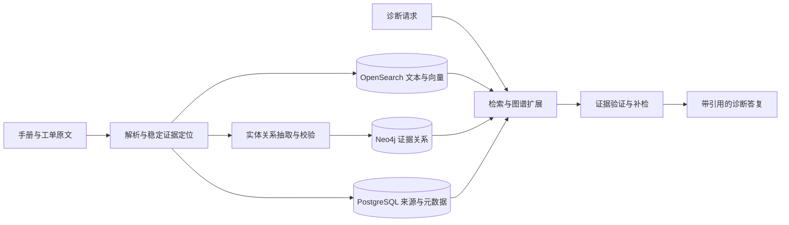

# 架构设计

状态：待实现。当前只提供数据与规范，不把示例图谱或人工答案伪装成运行产物。

## 数据流

## 组件职责

| 组件 | 唯一主要职责 | 不承担的职责 |
| --- | --- | --- |
| PostgreSQL | 文档/片段元数据、版本、导入任务和诊断记录的权威存储 | 不重复充当向量库 |
| OpenSearch | BM25 与向量召回，型号和版本元数据过滤 | 不保存评测答案 |
| Neo4j | 有来源的实体关系与有界遍历 | 关系不能取代原文证据 |
| LangGraph | 显式状态、条件路由、补检循环 | 不负责数据真实性认证 |
| FastAPI | 请求校验、诊断调用、返回结果 | 不把业务控制逻辑放进路由 |
| BGE-Reranker | 对统一候选文本进行相关性精排 | 精排分数不是事实可靠性或置信概率 |
| Langfuse | 记录每步耗时、输入输出 Token、工具轨迹和实验标识 | 不取代离线评测结果文件 |

依赖版本在实际实现时锁定；本阶段不添加空服务、占位容器或未经验证的部署配置。遵循用户选定的 Langfuse，不另增第二套追踪系统。

## 诊断流程

`normalize → plan → retrieve → verify → (supplement → retrieve → verify)* → generate → validate_citations → end`

- normalize：规范型号、保留故障码原值，解析诊断时点。型号缺失且影响适用性时询问，不猜测。
- plan：提出需要核实的症状、部件和原因，以及要检索的证据类型。
- retrieve：BM25 与向量各召回候选；采用相同的适用性过滤。以 RRF 融合排名、按稳定证据 ID 去重，再用 Reranker 精排。
- graph expansion：将链接到的实体限制在适用型号内扩展，取回关系的 `evidence_id`，映射到原文后进入同一精排池。一个片段从多个路径到达只计一次。
- verify：检查证据是否覆盖候选根因、是否有反例、型号/版本是否适用，以及哪些检查仍未完成。
- supplement：按缺口选择一次查询改写、历史工单检索或图谱扩展；记录输入缺口、动作和新增证据。
- generate：只根据可用证据答复；历史工单提供类比，不证明当前故障。
- validate_citations：引用必须属于本次已检索证据，位置和适用性有效；无依据的断言删除或降级为待验证假设。

## 状态和停止规则

计划状态字段：`request`、`plan`、`queries`、`evidence_ids`、`candidate_causes`、`missing_evidence`、`retrieval_round`、`new_evidence_count`、`stop_reason`、`usage`。

初始检索计第 1 轮，默认最多 3 轮；图谱默认最多 2 跳、50 个节点、100 条边。它们是初始实验参数，后续实验必须记录实际值。

依次判断：

1. 证据充分且无关键适用性冲突 → `sufficient`。
2. 达到轮次上限 → `max_rounds`，未充分的部分仍标记不足。
3. 一次补检后没有新增且适用的稳定证据 ID → `no_new_evidence`。
4. 上游不可用 → `source_unavailable`，返回已知限制，不无限重试。

LangGraph 自身递归限制是最后保护，不作为业务轮次统计。查询改写带回同一段文字不算新增证据。

## 可复现记录

每次诊断保存 corpus 版本、索引版本、Git commit、模型完整标识、提示词版本、检索参数、每轮候选和排名、图谱路径、停止原因与逐调用 usage。离线入库/抽取成本与在线诊断成本分开。

LangGraph 的状态和条件边设计依据：[官方 overview](https://docs.langchain.com/oss/python/langgraph/overview)、[Graph API](https://docs.langchain.com/oss/python/langgraph/graph-api)（2026-10-13 查阅）。具体实现时再次核对 API。
